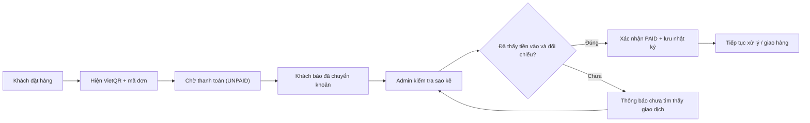
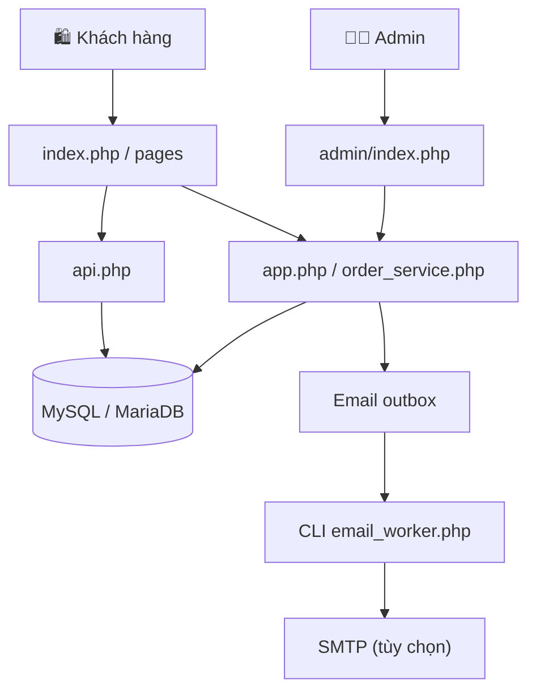

<div align="center">


<br />

# 🛒 BANHANG · TECH STORE

**Website thương mại điện tử thiết bị công nghệ — xây dựng với PHP thuần và MySQL/MariaDB.**

*Trải nghiệm mua sắm hiện đại ở frontend. Quản lý sản phẩm, đơn hàng, thanh toán và chăm sóc khách hàng ở backend.*

<br />

[](https://www.php.net/)
[](https://www.mysql.com/)
[](https://mariadb.org/)
[](https://www.apachefriends.org/)

[](https://github.com/tranquynhchi2109/BanHang/actions/workflows/php-lint.yml)
[](https://github.com/tranquynhchi2109/BanHang/stargazers)
[](https://github.com/tranquynhchi2109/BanHang/commits/main)
[](https://github.com/tranquynhchi2109/BanHang)

<br />

[**✨ Tổng quan**](#overview) ·
[**🧩 Tính năng**](#features) ·
[**🚀 Cài đặt**](#quickstart) ·
[**💳 Thanh toán**](#payments) ·
[**🗂️ Kiến trúc**](#structure) ·
[**🧪 Kiểm thử**](#testing)

</div>

---

<a id="overview"></a>
## ✨ Tổng quan dự án

**BanHang Tech Store** là dự án website bán các sản phẩm công nghệ như điện thoại, laptop và phụ kiện. Ứng dụng gồm **giao diện mua hàng**, **khu vực quản trị**, **cơ sở dữ liệu MySQL**, **theo dõi đơn hàng** và **quy trình xác nhận thanh toán**.

Không cần framework hoặc Composer: ứng dụng chạy với **PHP 8.2+**, Apache và MySQL/MariaDB.

<table>
<tr>
<td width="33%" align="center">🛍️<br /><b>Storefront</b><br /><sub>Khám phá · tìm kiếm · giỏ hàng · đặt hàng</sub></td>
<td width="33%" align="center">🧑‍💻<br /><b>Admin Dashboard</b><br /><sub>Sản phẩm · đơn hàng · đối soát · nội dung</sub></td>
<td width="33%" align="center">🔔<br /><b>Order Experience</b><br /><sub>Thông báo · timeline · email tùy chọn</sub></td>
</tr>
</table>

> [!IMPORTANT]
> **Đây là mã nguồn dự án, không phải dịch vụ thanh toán tự động.** VietQR chỉ hỗ trợ tạo thông tin chuyển khoản. Đơn chuyển khoản chỉ được đánh dấu **đã thanh toán** sau khi quản trị viên kiểm tra **tiền vào trên sao kê ngân hàng** và xác nhận thủ công. Không có API ngân hàng hay webhook xác minh giao dịch.

<a id="features"></a>
## 🧩 Tính năng nổi bật

<table>
<tr>
<td width="50%" valign="top">

### 🛒 Dành cho khách hàng

- 🏠 Trang chủ, banner và danh sách sản phẩm công nghệ.
- 🔎 Tìm kiếm và duyệt theo danh mục.
- 📱 Chọn phiên bản dung lượng điện thoại.
- 🛍️ Thêm, cập nhật số lượng và xóa sản phẩm trong giỏ.
- 👤 Đăng ký, đăng nhập, cập nhật tài khoản, đổi mật khẩu.
- 📦 Đặt hàng bằng **COD** hoặc **chuyển khoản ngân hàng**.
- 🚚 Theo dõi trạng thái đơn và lịch sử vận chuyển.
- 🔔 Nhận thông báo đơn hàng trong tài khoản.

</td>
<td width="50%" valign="top">

### 🛠️ Dành cho quản trị viên

- 📦 Quản lý sản phẩm, tồn kho, danh mục.
- 🏷️ Quản lý giá bán và giá theo dung lượng.
- 🧾 Tra cứu, xác nhận và xử lý đơn hàng.
- 💳 Đối soát chuyển khoản bằng mã giao dịch và số tiền thực nhận.
- 💰 Xác nhận thu tiền COD riêng biệt.
- 🚛 Cập nhật đơn vị vận chuyển và mã vận đơn.
- 📈 Phân biệt doanh thu đã thu và đơn chưa thanh toán.
- 📰 Quản lý bài viết, tin tức và thông tin website.

</td>
</tr>
</table>

### ⚡ Trải nghiệm & vận hành

| Hạng mục | Cách hoạt động |
| --- | --- |
| **Thông báo** | Lưu trong `tbl_notifications`; có chuông, badge chưa đọc, trang danh sách và liên kết tới đơn hàng. |
| **Cập nhật trạng thái** | `api.php` polling khoảng **20 giây**, tạm dừng khi tab không hiển thị. |
| **Lịch sử đơn hàng** | Timeline thể hiện các mốc *đã thực sự xảy ra*, kèm ghi chú và thông tin giao vận. |
| **Email tùy chọn** | SMTP outbox được gửi qua **CLI worker**, không gửi trực tiếp trong transaction HTTP. |
| **Bảo vệ dữ liệu** | Kiểm tra CSRF, session, prepared statements, kiểm tra giá/tồn kho khi checkout. |
| **CI** | GitHub Actions lint PHP và chạy integration tests trên **MySQL 8.0** / **MariaDB 10.11**. |

<details>
<summary><b>🖼️ Xem tài nguyên hình ảnh có sẵn trong repository</b></summary>

<br />

<div align="center">


<br /><br />


<sub>Đây là các file banner của dự án, không phải ảnh chụp màn hình một phiên bản đang triển khai.</sub>

</div>

</details>

<a id="stack"></a>
## 🧰 Công nghệ sử dụng

<div align="center">

[](https://skillicons.dev)

</div>

| Thành phần | Công nghệ / nhiệm vụ |
| --- | --- |
| **Backend** | PHP 8.2+, PDO, một số module tương thích dùng MySQLi |
| **Frontend** | HTML, CSS, JavaScript thuần |
| **Database** | MySQL / MariaDB, charset `utf8mb4` |
| **Local development** | XAMPP (Apache + PHP + MySQL/MariaDB), phpMyAdmin |
| **Thanh toán** | COD và VietQR **đối soát thủ công** |
| **Thông báo** | MySQL + polling qua `api.php` |
| **Email** | SMTP tùy chọn + bảng `tbl_email_outbox` + CLI worker |
| **Kiểm thử** | PHP lint, GitHub Actions, integration tests |

<a id="quickstart"></a>
## 🚀 Cài đặt & chạy trên XAMPP

<details open>
<summary><b>💻 Hướng dẫn nhanh — Windows / XAMPP</b></summary>

<br />

**Yêu cầu:** PHP **8.2+** với `pdo_mysql`, `mysqli`, `mbstring`, `fileinfo`; Apache; MySQL/MariaDB; Git (để clone).

**1. Tải mã nguồn vào thư mục `htdocs`**

```powershell
cd C:\xampp\htdocs
git clone https://github.com/tranquynhchi2109/BanHang.git web_banhang
cd web_banhang
```

**2. Khởi động** Apache và MySQL trong XAMPP Control Panel.

**3. Tạo hoặc chọn database** `web_mysqli` tại [http://localhost/phpmyadmin](http://localhost/phpmyadmin).

> [!CAUTION]
> Nếu database **đã chứa dữ liệu**, hãy **Export/Backup toàn bộ** trước khi nâng cấp. Đừng import SQL mẫu cũ, đừng xóa bảng để "cài lại" và đừng đưa file backup có dữ liệu khách hàng lên GitHub.

**4. Import đúng file duy nhất** [`banhang.sql`](banhang.sql) vào database đã chọn qua tab **Import** của phpMyAdmin.

Bạn cũng có thể dùng CLI (sau khi bảo đảm database đích đã được tạo):

```bash
mysql -u root -p -D web_mysqli < banhang.sql
```

**5. Tạo file cấu hình máy local** (đã được `.gitignore` bỏ qua):

```powershell
Copy-Item admin\config\config.local.example.php admin\config\config.local.php
```

Mở `admin/config/config.local.php` và kiểm tra `DB_HOST`, `DB_PORT`, `DB_NAME`, `DB_USER`, `DB_PASS`. Mặc định hướng tới `127.0.0.1:3306`, database `web_mysqli`, user `root`. Chỉ dùng tài khoản root không mật khẩu cho môi trường demo local; môi trường thực tế cần tài khoản database quyền tối thiểu.

**6. Truy cập ứng dụng**

| Vị trí | Đường dẫn |
| --- | --- |
| 🛒 Website khách hàng | [`http://localhost/web_banhang/`](http://localhost/web_banhang/) |
| 🧑‍💻 Trang quản trị | [`http://localhost/web_banhang/admin/`](http://localhost/web_banhang/admin/) |
| 🗄️ phpMyAdmin | [`http://localhost/phpmyadmin/`](http://localhost/phpmyadmin) |

**Lưu ý:** Repo không công bố một tài khoản Admin mặc định để sử dụng chung. Hãy dùng tài khoản quản trị hợp lệ đã có trong database và thay mọi mật khẩu demo trước khi triển khai công khai.

</details>

<details>
<summary><b>🐧 Ubuntu / Apache / MariaDB</b></summary>

<br />

Nếu bạn dùng Ubuntu, hãy cấu hình Apache, PHP 8.2+ cùng các extension cần thiết và MySQL/MariaDB tương thích, sau đó thực hiện quy trình tương tự.

```bash
git clone https://github.com/tranquynhchi2109/BanHang.git
cd BanHang
cp admin/config/config.local.example.php admin/config/config.local.php
# Chỉnh lại thông tin DB trong config.local.php.
# Tạo database đích, backup nếu đã có dữ liệu rồi mới import:
mysql -u root -p -D web_mysqli < banhang.sql
```

Cấu hình Apache `DocumentRoot`/`Alias` trỏ tới thư mục dự án; bật các quy tắc `.htaccess` khi triển khai. Không mở trực tiếp file config, module nội bộ hoặc worker CLI ra Internet.

</details>

<a id="payments"></a>
## 💳 Thanh toán & đối soát — thiết kế minh bạch

### Chuyển khoản ngân hàng (VietQR / MB Bank)



| Bước | Người thực hiện | Ý nghĩa |
| --- | --- | --- |
| **1. Đặt đơn BANK** | Khách hàng | Tạo đơn và hiển thị QR, số tiền, nội dung chuyển khoản có mã đơn. Trạng thái vẫn **`UNPAID`**. |
| **2. Báo đã chuyển** | Khách hàng | Nút báo chuyển khoản tạo tín hiệu **`REPORTED`**, **không** xác nhận tiền đã đến. |
| **3. Đối chiếu thực tế** | Admin | Kiểm tra tài khoản nhận, số tiền, mã đơn và mã giao dịch từ sao kê ngân hàng thật. |
| **4. Xác nhận** | Admin | Khi đã đối chiếu, nhập mã giao dịch / số tiền thực nhận; hệ thống chuyển **`PAID`** và ghi nhật ký vào `tbl_payment_events`. |
| **5. Chưa có tiền** | Admin | Báo chưa tìm thấy giao dịch; khách có thể kiểm tra và báo lại. |

**Quy tắc quan trọng:** Đơn **BANK chưa `PAID`** không được xác nhận/giao hàng. Đơn chờ quá 24 giờ có thể được Admin **hủy thủ công theo điều kiện của hệ thống** và hoàn tồn kho; không có tác vụ tự động hủy hay tự hoàn tiền. Nếu tiền đến sau khi đơn bị hủy, phải xử lý thủ công với khách.

### Thanh toán khi nhận hàng (COD)

Khách chọn **COD** khi checkout. Việc giao hàng và việc **đã thu tiền** là hai trạng thái riêng. Admin chỉ ghi nhận **`PAID`** sau khi xác nhận thu tiền COD. Vì vậy doanh thu thực nhận không tính những đơn chuyển khoản `UNPAID` hoặc COD chưa thu tiền.

> [!WARNING]
> **QR, ảnh chụp giao dịch và nút "Tôi đã chuyển khoản" không phải bằng chứng ngân hàng đã nhận tiền.** Hệ thống không kết nối API MB Bank, không có webhook xác nhận tự động, không thu thông tin thẻ/CVV và không tự hoàn tiền.

### ✋ Khách tự hủy đơn hoặc đổi phương thức thanh toán

- **Trước khi xác nhận đặt hàng:** khách có thể quay lại giỏ, không có đơn mới được tạo.
- **Đơn `PENDING` + `UNPAID`, chưa báo chuyển khoản:** khách có thể **tự hủy ngay** (phải chọn lý do). Với VietQR, khách phải xác nhận **chưa chuyển tiền**; hệ thống trả tồn kho **một lần**, lưu timeline, thông báo và email tùy chọn.
- **Đổi COD ↔ VietQR:** chỉ cho phép khi còn `PENDING`, chưa thanh toán và chưa có lịch sử báo chuyển khoản. Khi đổi sang BANK lần đầu, tạo snapshot VietQR cố định trong `tbl_order_payment_details`.
- **Đã báo chuyển khoản, đã thanh toán hoặc Admin đã xác nhận/đang chuẩn bị:** tạo **yêu cầu hủy** trong `tbl_order_cancel_requests` để Admin duyệt hoặc từ chối; không tự hủy, hoàn kho hay hoàn tiền.
- **Admin:** tại Quản lý đơn hàng có đường dẫn lọc yêu cầu chờ duyệt, xem lý do và quyết định. Thao tác dùng database transaction và khóa đơn để chống xử lý trùng. Đơn đã thanh toán phải xử lý đối soát/hoàn tiền thủ công.
- **Đơn đang giao/đã giao:** liên hệ cửa hàng để thực hiện quy trình hậu mãi, không tự hủy.

> [!IMPORTANT]
> **Cập nhật máy local:** backup database **trước**, import lại đúng `banhang.sql` vào database đang dùng (file SQL tạo thêm `tbl_order_cancel_requests`), rồi mới `git pull`. Nếu chỉ pull code mà chưa nâng cấp SQL, trang chi tiết đơn hàng có thể lỗi thiếu bảng. Các bài kiểm tra riêng nằm trong `tests/customer_order_actions.php` và chạy với database test cô lập.

<a id="orders"></a>
## 📦 Vòng đời đơn hàng & thông báo

<div align="center">

**Đã đặt hàng** → **Đã xác nhận** → **Đang chuẩn bị** → **Đang giao** → **Đã giao thành công**

<sub>Hoặc chuyển sang <b>Đã hủy</b> kèm lý do theo các quy tắc xử lý đơn.</sub>

</div>

- **Timeline đơn hàng:** lưu lịch sử tại `tbl_order_status_history`, chỉ đánh dấu các bước thực tế đã diễn ra; hỗ trợ đơn vị vận chuyển, mã vận đơn, ghi chú nội bộ và ghi chú cho khách.
- **Thông báo trong website:** lưu ở `tbl_notifications`, hiển thị badge chưa đọc, dropdown nhanh và trang [`?page=notifications`](index.php?page=notifications). Mỗi khách chỉ thấy thông báo thuộc tài khoản mình.
- **Cập nhật gần thời gian thực:** `api.php` kiểm tra thông báo và trạng thái đơn theo chu kỳ khoảng 20 giây; tạm dừng khi tab ẩn, có giới hạn tần suất.
- **Email tùy chọn:** các sự kiện được đưa vào `tbl_email_outbox`. Nếu SMTP chưa cấu hình, chức năng mua sắm và thông báo trong website vẫn hoạt động.

<a id="structure"></a>
## 🗂️ Kiến trúc & tổ chức mã nguồn

```text
BanHang/
├── .github/
│   ├── assets/                 # Banner minh họa README
│   └── workflows/php-lint.yml  # CI: PHP + MySQL/MariaDB
├── admin/
│   ├── config/                 # Kết nối DB, cấu hình local/SMTP
│   ├── modules/                # Module quản lý sản phẩm, đơn, bài viết...
│   └── index.php               # Entry point trang Admin
├── css/                        # Stylesheet
├── images/                     # Ảnh sản phẩm và banner có sẵn
├── js/                         # JavaScript frontend
├── pages/                      # Giao diện cửa hàng
├── scripts/email_worker.php    # Worker email (chỉ CLI)
├── tests/                      # Integration tests
├── index.php                   # Entry point khách hàng
├── api.php                     # API thông báo, trạng thái đơn
├── app.php                     # Cấu hình chung, helpers, session, DB
├── order_service.php           # Nghiệp vụ đơn hàng / thanh toán
├── mailer.php                  # Email outbox / SMTP
├── banhang.sql                 # SQL tạo / nâng cấp schema
└── README.md
```



### 🧪 Bộ dữ liệu demo nhiều đơn hàng (tùy chọn)

Muốn thử Admin với nhiều đơn? Dùng [database/seed_demo_orders.sql](database/seed_demo_orders.sql) để tạo **240 đơn hàng giả lập**, **480 dòng chi tiết đơn**, **20 khách giả** và dữ liệu hủy/đối soát. Tất cả dùng **chung danh mục sản phẩm hiện có**; 16 sản phẩm fixture nội bộ được giữ ẩn để không nhân đôi hàng đang bán, đồng thời không làm hỏng lịch sử đơn đã nạp. Xem [hướng dẫn import và sửa danh mục [DEMO] cũ](database/README.md).

> [!CAUTION]
> Đây là **dữ liệu giả** có cả trạng thái PAID mô phỏng, **không phải doanh thu thật**. File seed **không được chạy tự động bởi banhang.sql**. Nên dùng database riêng web_mysqli_demo; trước khi chủ động nhập vào database local hiện có, phải backup và bật opt-in trong file seed.

<a id="database"></a>
## 🗄️ Dữ liệu, tồn kho & giá theo dung lượng

Dự án dùng **`banhang.sql` làm file SQL chuẩn duy nhất** để tạo/nâng cấp cấu trúc. File SQL hoạt động trên **database đang được chọn**; không tự chuyển sang schema khác.

| Dữ liệu | Nguồn |
| --- | --- |
| Sản phẩm, danh mục, khách hàng | `tbl_sanpham`, `tbl_danhmuc`, `tbl_dangky` |
| Giá dung lượng điện thoại | `tbl_product_variants` |
| Đơn hàng và sản phẩm trong đơn | `tbl_orders`, `tbl_order_items` |
| Cài đặt và thông tin nhận tiền | `tbl_settings` |
| Lịch sử đối soát | `tbl_payment_events` |
| Timeline và thông báo | `tbl_order_status_history`, `tbl_notifications` |
| Hàng đợi email | `tbl_email_outbox` |

### Đồng bộ giá frontend ↔ database

- **Điện thoại:** giá bán đọc từ `tbl_product_variants` theo dung lượng `128GB`, `256GB`, `512GB`, `1TB`.
- **Laptop và phụ kiện:** giá từ `tbl_sanpham.giasp`.
- **Giỏ hàng / checkout:** sử dụng logic `variant_price()` thống nhất; nếu biến thể chưa có giá hợp lệ, không tự cho giá `0đ`.
- **Khi tạo đơn:** đọc lại giá và tồn kho trong transaction, đối chiếu với tổng tiền khách đã thấy.
- **Tồn kho:** hiện được lưu chung ở `tbl_sanpham.soluong`, **chưa** quản lý riêng từng dung lượng.

<details>
<summary><b>💡 Lưu ý về giá chuyển đổi từ frontend cũ</b></summary>

<br />

Script nâng cấp có thể chuyển các mức giá từng hiển thị trên giao diện cũ vào bảng biến thể (ví dụ quy tắc cũ: 128GB = giá gốc; 256GB +2 triệu; 512GB +5 triệu; 1TB +10 triệu). Đây **không phải báo giá thị trường đã được xác minh**. Hãy kiểm tra và chỉnh từng giá trong Admin trước khi nhận đơn thực tế. Script sử dụng cơ chế tránh ghi đè giá biến thể mà Admin đã thiết lập.

Mã nguồn trên GitHub **không thể tự cập nhật MySQL localhost** của máy bạn. Việc chạy `banhang.sql` vào database đích phải được thực hiện trên chính máy chủ.

</details>

<a id="updating"></a>
## 🔄 Nâng cấp mà không mất dữ liệu

> [!CAUTION]
> **BẮT BUỘC BACKUP TRƯỚC KHI IMPORT SQL.** Đừng chạy integration tests trên database đang phục vụ khách. Đừng dùng file dump mẫu/cũ để ghi đè dữ liệu thật.

1. Trong **phpMyAdmin**, chọn database đích (thường là `web_mysqli`), dùng **Export** để sao lưu toàn bộ. Cất bản sao ngoài thư mục web.
2. Chọn lại **đúng database đích**, tab **Import**, chỉ nhập file **`banhang.sql`** ở phiên bản mới nhất.
3. Nếu gặp thông báo **`BANHANG_STOP_DUAL_TABLES_BACKUP_AND_RECONCILE`**, **dừng**: tồn tại cả bảng `v2_*` lẫn `tbl_*` tương ứng; cần kiểm tra dữ liệu trước khi quyết định xử lý, **không tự DROP**.
4. Cập nhật source code:

   ```powershell
   cd C:\xampp\htdocs\web_banhang
   git switch main
   git pull origin main
   ```

5. Kiểm tra giá bán theo dung lượng, cấu hình tài khoản nhận chuyển khoản trong Admin và chạy một đơn COD thử từ sản phẩm → giỏ → checkout → trang đơn.
6. Chỉ mở thanh toán ngân hàng khi đã xác minh **tài khoản MB Bank nhận tiền, tên người nhận và số tiền** trên môi trường thực tế.

SQL dùng các thao tác tạo bảng nếu chưa có và nâng cấp có kiểm tra xung đột; có thể import lại theo thiết kế nhưng **backup vẫn bắt buộc** trước mọi nâng cấp.

**Rollback:** sử dụng bản export ở bước 1 để phục hồi database và quay mã nguồn về một commit ổn định tương ứng. Cần kiểm tra tương thích giữa phiên bản code và schema khi khôi phục.

<a id="email"></a>
## ✉️ Email SMTP & worker (tùy chọn)

Website dùng cơ chế **outbox**: ghi yêu cầu email vào DB, rồi để worker gửi email sau. Không gửi SMTP ngay trong request checkout/thanh toán.

**1. Cấu hình:** Sao chép `admin/config/config.local.example.php` thành `admin/config/config.local.php`, điền:

| Key | Vai trò |
| --- | --- |
| `SMTP_HOST` | Host SMTP (để trống = không gửi email) |
| `SMTP_PORT` | Ví dụ `587` (TLS) hoặc `465` (SSL) |
| `SMTP_SECURE` | `tls` / `ssl` / `none` |
| `SMTP_USER` / `SMTP_PASS` | Tài khoản và mật khẩu ứng dụng SMTP |
| `SMTP_FROM_EMAIL` | Địa chỉ gửi email |
| `SMTP_FROM_NAME` | Tên hiển thị người gửi |

**2. Kiểm tra worker mà không gửi email:**

```powershell
C:\xampp\php\php.exe C:\xampp\htdocs\web_banhang\scripts\email_worker.php --dry-run
```

**3. Chạy worker:**

```powershell
C:\xampp\php\php.exe C:\xampp\htdocs\web_banhang\scripts\email_worker.php --limit=10 --stale-minutes=5
```

**4. Chạy định kỳ:** Windows **Task Scheduler** → **Create Task** → Trigger lặp mỗi **1 phút**; Action `Start a program`:

- **Program:** `C:\xampp\php\php.exe`
- **Arguments:** `C:\xampp\htdocs\web_banhang\scripts\email_worker.php --limit=10 --stale-minutes=5`
- **Start in:** `C:\xampp\htdocs\web_banhang`
- Chọn **Do not start a new instance** khi tác vụ trước còn chạy.

Worker chỉ chạy với PHP CLI và có chặn truy cập qua HTTP. Email ở trạng thái `SKIPPED` **không tự gửi lại** sau khi cấu hình SMTP; thao tác gửi lại email lịch sử cần được Admin xác nhận riêng. **Không commit thông tin SMTP thật lên GitHub.**

<a id="testing"></a>
## 🧪 Kiểm thử & CI

<div align="center">

[](https://github.com/tranquynhchi2109/BanHang/actions/workflows/php-lint.yml)

<sub>GitHub Actions chạy trên MySQL 8.0 và MariaDB 10.11.</sub>

</div>

Các kiểm thử bao gồm PHP lint, import SQL lặp lại, bảo vệ cấu hình đã lưu, checkout và khóa tồn kho, đối soát chuyển khoản, thông báo/trạng thái đơn, SMTP outbox và khả năng nâng cấp dữ liệu cũ.

**Chạy local (PowerShell):**

1. Tạo database **riêng** `web_mysqli_test` và import `banhang.sql` vào đúng database này.
2. Chạy các lệnh sau (chỉnh thông tin DB cho phù hợp):

```powershell
$env:BANHANG_TEST_MODE = "1"
$env:DB_HOST = "127.0.0.1"
$env:DB_NAME = "web_mysqli_test"
$env:DB_USER = "root"
$env:DB_PASS = ""

C:\xampp\php\php.exe tests\manual_payment.php
C:\xampp\php\php.exe tests\order_notifications.php
C:\xampp\php\php.exe tests\critical_hardening.php
```

> [!WARNING]
> Test tạo/xóa dữ liệu fixture. Ứng dụng từ chối integration test nếu không chạy bằng **CLI**, thiếu `BANHANG_TEST_MODE=1` hoặc `DB_NAME` không có hậu tố `_test` / `_testing` / `_ci`. **Tuyệt đối không chạy trên `web_mysqli` đang chứa dữ liệu thật.**

<a id="security"></a>
## 🔐 Bảo mật & giới hạn hiện tại

- ✅ Sử dụng PDO prepared statements cho các truy vấn ứng dụng chính, session cookie cấu hình chặt chẽ, CSRF token và các HTTP security headers.
- ✅ Không thu thập số thẻ, CVV hoặc OTP; không đánh dấu chuyển khoản thành công dựa trên ảnh chụp hoặc nút báo của khách.
- ⚠️ **Không có đối soát ngân hàng tự động**, refund tự động hay tồn kho riêng cho từng dung lượng.
- ⚠️ Dự án chưa được kiểm thử tải hoặc đánh giá bảo mật độc lập đầy đủ; **không nên coi là sẵn sàng production ngay**.
- ⚠️ Hãy triển khai HTTPS, giới hạn quyền MySQL, thay mật khẩu demo, cập nhật PHP và thiết lập sao lưu định kỳ.
- 🖼️ Ưu tiên ảnh upload nội bộ hoặc trong `images/`. Một số ảnh demo có thể tham chiếu nguồn ngoài — xem [`MEDIA_SOURCES.md`](MEDIA_SOURCES.md) để kiểm tra quyền sử dụng trước khi dùng thương mại.

<a id="contributing"></a>
## 🤝 Đóng góp

Bạn có thể mở [Issue](https://github.com/tranquynhchi2109/BanHang/issues) để báo lỗi hoặc gửi [Pull Request](https://github.com/tranquynhchi2109/BanHang/pulls) để đề xuất cải tiến. Vui lòng không đưa thông tin đăng nhập, sao kê ngân hàng hay dữ liệu khách hàng thật vào issue/commit.

---

<div align="center">

### 💙 Built with PHP, powered by thoughtful engineering

**BANHANG TECH STORE**

*Shopping made simple. Orders made transparent.*

[⬆️ Về đầu trang](#-banhang--tech-store) · [📂 Source code](https://github.com/tranquynhchi2109/BanHang) · [🐛 Báo lỗi](https://github.com/tranquynhchi2109/BanHang/issues)

<sub>© BanHang contributors · Documentation for the open GitHub repository</sub>

</div>
